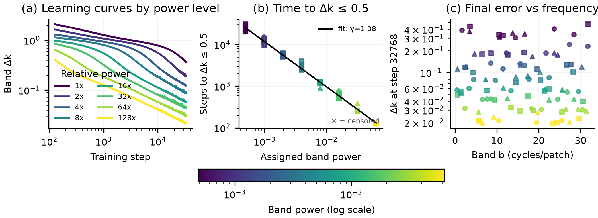

# Power allocation and learning schedules

## TLDR

At a fixed 32,768-step budget, final error falls monotonically with assigned power
(Spearman `−0.992`) and is unrelated to carrier frequency (`−0.090`). Across the full
power ladder, time-to-threshold follows `t ∝ P^{-1.08}` with `R²=0.999`.

## What it does

Each run draws a fresh dense spectrum of 32 coherent tones with independent random
phases, total power 0.5, and no observation noise. Frequencies start from a uniform
grid at `0.5, 1.5, ..., 31.5` and receive i.i.d. jitter in `[-0.25, 0.25]`. The jitter
keeps adjacent frequencies at least 0.5 apart, bounding the coefficient basis
condition number while still randomizing the spectrum between runs. Power levels are
assigned by an independent random permutation, so the three runs share no fixed
frequency-power pairing.

Patch size is 64: its 64 real degrees of freedom exactly determine the 32 tones' 64
amplitude/phase parameters. Per-band coefficients are recovered by jointly inverting
the full 32-tone cos/sin basis, not by applying 32 separate matched filters.

Power is assigned on a base-2 ladder with eight levels:

| level | relative weight | bands per corpus |
| ---: | ---: | ---: |
| 0–7 | `1, 2, 4, ..., 128` | exactly 4 each |

Powers are normalized to total 0.5, so the weakest band carries `0.5/1020` and the
strongest `128/1020`.

- Model: context 512, patch 64, hidden 128, two layers, four heads, nonlinear encoder.
  Training adds a ninth target patch, 576 samples total.
- Training: 32,768 SGD steps, batch 256, learning rate 0.04.
- Runs: three independent task draws; each changes frequencies, power pairing, initial
  phases, model initialization, and batch order.
- Checkpoints: every 128 steps.
- Readout: clean probes; per-band `r`, `Δk`, and held-out variance explained.

The scaling fit is

\[
\log t = a - \gamma \log P,
\]

fitted on reached power levels only. A positive `γ` means lower power requires a
longer schedule. This is a fixed-budget measurement, not an asymptotic convergence
claim.

## Results



*Per-band `Δk` at the final checkpoint. (a) Curves pooled over the twelve band–run
assignments at each power level. (b) Steps to `Δk <= 0.5`; symbols mark runs and
crosses mark censored bands. (c) Final error against carrier frequency, coloured by
assigned power.*

| level | power per band | final `Δk` | mean `t(Δk≤0.5)` | reached at 0.5 |
| ---: | ---: | ---: | ---: | ---: |
| 0 | 0.098% | 0.366 | 23,989 | 12/12 |
| 1 | 0.196% | 0.191 | 11,723 | 12/12 |
| 2 | 0.392% | 0.123 | 5,632 | 12/12 |
| 3 | 0.784% | 0.086 | 2,923 | 12/12 |
| 4 | 1.569% | 0.057 | 1,216 | 12/12 |
| 5 | 3.137% | 0.044 | 619 | 12/12 |
| 6 | 6.275% | 0.030 | 267 | 12/12 |
| 7 | 12.549% | 0.022 | 128 | 12/12 |

- Final `Δk` is strictly monotone in level means; Spearman with log power is
  `−0.992`. Spearman with carrier frequency is `−0.090`.
- The `Δk≤0.5` fit uses all eight levels: `γ=1.083`, `R²=0.999`. Per-run fits give
  `γ = 1.09, 1.10, 1.06`.
- Stricter targets: `Δk≤0.2` reaches 82/96 bands over seven levels, `γ=1.022`,
  `R²=0.997`; `Δk≤0.1` reaches 59/96 bands over five levels, `γ=0.935`,
  `R²=0.999`.
- Held-out variance explained is at least 0.997.
- The fastest level reaches the first checkpoint (128 steps), so its time is
  right-censored at the resolution floor. The exponent is therefore approximate and
  should be refined with earlier checkpoints before publication.

## How to run

```bash
make -j3          # default: runs 0, 1, 2 on CUDA
make clean
```

Each run writes `outputs/power_s<seed>.json`; merged records and the figure land in
`outputs/power.json` and `figs/power.png`.
