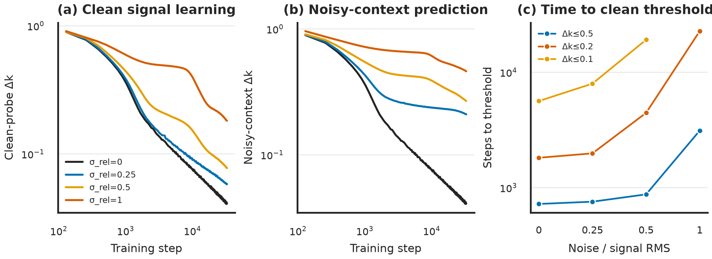
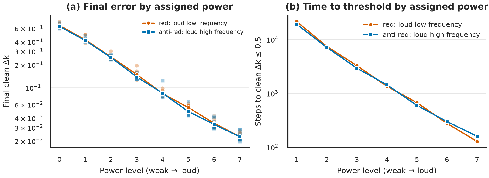

# SNR and learning schedules

## TLDR

Full-spectrum white noise slows learning of deterministic tones: the mean steps to
clean-probe `Δk≤0.5` rise from 723 without noise to 3,119 at noise/signal RMS 1. The
red versus anti-red control reverses which frequencies are loud, yet matched power
levels remain nearly identical, so carrier frequency is not the driver.

## What it does

Each run uses the same dense 32-band model as the power experiment: `k=64`,
`ctx=512`, `H=128`, two layers, four heads. Frequencies use the conditioned jittered
grid. Training adds independent per-sample Gaussian noise to both context and target.
Noise is never synthesized from a window's own FFT coefficients.

`snr` suite: all tones have equal power. Sweep noise amplitude
`sigma_rel ∈ {0, 0.25, 0.5, 1.0}`, where `sigma_rel` is noise RMS divided by signal
RMS. The JSON stores absolute `sigma`; the figure converts it back to `sigma_rel`.
Carrier frequency and signal power are constant, so every band has the same nominal
SNR.

`assignment` suite: hold the same power multiset and noise variance, but mirror the
power-frequency assignment.

- `red`: high power at low frequency, low power at high frequency.
- `anti_red`: the reverse.

Noise is calibrated so the weakest level has in-band SNR 1 in both assignments; the
realized `σ` is 0.12524 in both.

For both suites, evaluate two probes:

- clean context -> clean target: measures learned deterministic signal coefficients;
- noisy context -> clean target: measures denoising and finite-context estimation.

Metrics are per-band `r` and `Δk` from joint cos/sin coefficient recovery, plus
variance explained against the clean target.

## Results

### Equal power: noise dose



*Per-band learning curves at equal signal power. (a) Clean-probe `Δk`. (b)
Noisy-context prediction against the clean target. (c) Mean steps to clean-probe
thresholds; thresholds that are never reached are omitted.*

| `σ_rel` | final clean `r` | final clean `Δk` | final noisy `Δk` | `t(Δk≤0.5)` | `t(Δk≤0.2)` | `t(Δk≤0.1)` |
| ---: | ---: | ---: | ---: | ---: | ---: | ---: |
| 0 | 0.995 | 0.041 | 0.041 | 723 | 1,815 | 5,620 |
| 0.25 | 0.965 | 0.058 | 0.209 | 756 | 1,981 | 7,956 |
| 0.5 | 0.950 | 0.077 | 0.267 | 875 | 4,440 | 19,072 |
| 1.0 | 0.844 | 0.181 | 0.460 | 3,119 | 22,645 (73/96) | not reached |

- Stronger noise delays the `Δk≤0.5` and `Δk≤0.2` thresholds and raises final clean
  attenuation; the `Δk≤0.1` threshold is not reached at `σ_rel=1` within 32k.
- The `Δk≤0.1` column is **not** a schedule for `σ_rel=1`: at 32k the mean clean `Δk`
  is 0.181 (per-band min 0.134), so the threshold lies below every band's current
  error. The clean `r` is still rising at 32k (`0.815` at 24k → `0.845` at 32k), so
  this is a budget-limited measurement, not a demonstrated fixed point.
- In the linear readout picture, context noise alone would *speed* convergence to a
  shrunk optimum (Hessian `P+σ²`). The observed `t(Δk≤0.5)` is 4.3× slower at
  `σ_rel=1`, so the net slowdown is not explained by ridge alone; target-noise
  gradient variance and nonlinear optimization dominate.
- The training loss also contains irreducible target noise, so raw loss is not a
  convergence measure; all schedule claims use clean-probe coefficients.
- This is a fixed 32k-step result. The clean probe has no observation noise, so its
  optimal prediction is `r=1`; the observed attenuation is a learned prior or
  finite-budget effect, not an information-theoretic floor.
- A context/target noise 2×2 and a scale-matched noiseless control are mechanism
  diagnostics; they are deferred to the ready version. The artificial context-only and
  target-only arms are not realistic data-generating processes.

### Red versus anti-red: frequency control



*Same power multiset and noise; only the frequency-power assignment is reversed.
(a) Final clean error by power level. (b) Clean-probe time to `Δk≤0.5`.*

| level | red `Δk` | anti-red `Δk` | red `t(Δk≤0.5)` | anti-red `t(Δk≤0.5)` |
| ---: | ---: | ---: | ---: | ---: |
| 0 | 0.652 | 0.635 | — | — |
| 1 | 0.425 | 0.416 | 21,536 | 19,221 |
| 2 | 0.253 | 0.249 | 7,424 | 7,147 |
| 3 | 0.149 | 0.138 | 3,275 | 2,933 |
| 4 | 0.084 | 0.085 | 1,355 | 1,440 |
| 5 | 0.055 | 0.049 | 672 | 597 |
| 6 | 0.034 | 0.033 | 277 | 299 |
| 7 | 0.023 | 0.023 | 128 | 160 |

Level 0 is censored at `Δk≤0.5` in both assignments. Matched-level absolute differences
are at most 0.018 in final `Δk`. After subtracting level means, the frequency residual
has Spearman `0.036` with final error. Reversing which frequencies are loud does not
change the learning schedule.

Within this suite, power level and in-band SNR are collinear: the noise has fixed
absolute `σ`, so louder bands also have higher SNR. The red/anti-red control isolates
frequency, not power versus SNR; power alone is handled by the power experiment.

## How to run

```bash
make -j3 snr             # three runs, all noise doses
make -j3 assignment      # three runs, red vs anti-red
make                     # both suites and figures
make clean
```
