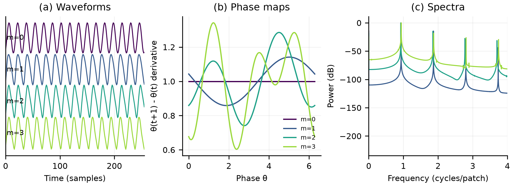
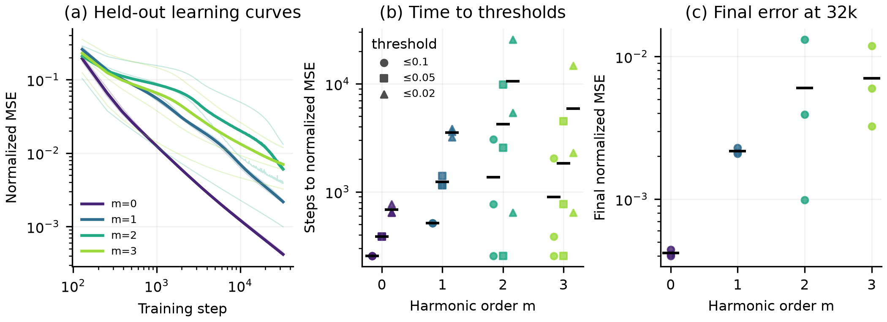

# Map complexity and learning schedules

## TLDR

Adding nonlinearity to the one-step phase map slows learning relative to a pure
rotation, but harmonic count is not a scalar complexity ordering. With power, carriers,
state dimension, and initialization fixed, `m=2` is on average slower than `m=3`, and
the ordering varies strongly across harmonic-phase realizations.

## What it does

Each carrier is a constant-envelope phase oscillator sampled at every time step:

\[
x_i(t)=A_i\cos\theta_i(t),
\qquad
\theta_i(t+1)=\theta_i(t)+\omega_i+
\sum_{k=1}^{m}\gamma_k\sin(k\theta_i(t)+\phi_k).
\]

- `ω_i` sets the carrier frequency.
- `m` is the discrete complexity level: 0 is a pure rotation; 1, 2, and 3 add
  nonlinear phase harmonics.
- Phase advances are defined per timestep, independent of patch boundaries.
- Harmonic amplitudes are normalized as `γ_k = β√(2/m)`, fixing RMS phase modulation
  at `β=0.1` across levels.
- Each window is RMS-normalized to total power 0.5. A circle map's invariant phase
  density need not be uniform, so constant instantaneous amplitude alone does not fix
  finite-window mean power.
- Phase recurrence is evaluated in float64; float32 accumulation creates spurious
  sidebands over long records.

Fixed carriers are `b = {0.5, 2.5, 4.5, 6.5}` cycles/patch. They are shared by every
seed and every `m`.

- `k=16`, `ctx=512`, `H=64`, two layers, four heads.
- 32,768 steps, batch 128, checkpoints every 128 steps.
- Each model contains all four carriers at one `m`; models are not mixtures of map
  orders. A mixed model would make full-waveform error impossible to attribute.
- Within a seed, `m=0,1,2,3` share carriers, initial phases, map phases, initial
  weights, and batch order. The three seeds vary phases, initialization, and batch
  order.
- Primary readout: full next-patch waveform MSE and variance explained. Phase
  modulation moves energy into sidebands, so a carrier-bin coefficient is not a
  sufficient readout.

## What is controlled, and what is not

| quantity | controlled? | mechanism |
| --- | --- | --- |
| total power | yes | constant envelope plus per-window RMS normalization |
| intrinsic state dimension | yes | one scalar phase per carrier; `m` adds harmonics, not state variables |
| carrier set | yes | four fixed carriers across all seeds and levels |
| map nonlinear order | manipulated | `m=0..3` |
| observed spectral bandwidth | **not fixed** | phase modulation creates sidebands; measured and reported |
| waveform complexity | changes with `m` | this is the treatment |

The experiment supports a narrower statement than “higher order is harder”:

> Nonlinear phase maps change the learning schedule relative to a pure rotation, but
> harmonic count alone is not a monotone measure of difficulty.

It does **not** support a cross-carrier invariance claim. A phase-modulated signal is
not a single carrier line: most power may sit near a carrier, but sidebands change the
effective input spectrum. Claims about carrier frequency itself are handled by the
power and SNR experiments.

A standard external PM signal would admit a Bessel decomposition and carrier-independent
sideband fractions. The autonomous generalized circle map used here does not: its
nonlinear term feeds back into the phase, so there is no exact `J_n(β)` decomposition.
The pilot measures the realized spectrum instead.

## Data pilot



*One carrier at `b=1` with identical initial phase. (a) Waveforms for `m=0..3`,
vertically offset. (b) Phase-map derivative over one phase period. (c) Spectra.*

| `m` | min derivative | phase RMS | spectral entropy | 95% bandwidth | RMS |
| ---: | ---: | ---: | ---: | ---: | ---: |
| 0 | 1.000 | 0.000 | 0.000 | 0.000 | 0.707 |
| 1 | 0.859 | 0.100 | 0.033 | 1.735 | 0.707 |
| 2 | 0.741 | 0.100 | 0.028 | 0.150 | 0.707 |
| 3 | 0.603 | 0.100 | 0.146 | 0.133 | 0.707 |

- All maps remain orientation-preserving (`min derivative > 0`).
- Total RMS is exactly fixed at `sqrt(0.5)`.
- Neither 95% bandwidth nor spectral entropy increases monotonically with `m`, so the
  pilot does not support a simple “more sidebands means slower learning” explanation.

## Results



*Three independent harmonic-phase realizations. Thin curves are individual seeds and
thick curves are means. (a) Held-out normalized MSE. (b) Steps to normalized-MSE
thresholds; marks are seeds, dashes are means. (c) Final error.*

| `m` | variance at 4096 | final variance | final range | `t(NMSE≤0.1)`, seeds |
| ---: | ---: | ---: | ---: | --- |
| 0 | 0.9971 | 0.9996 | 0.9996–0.9996 | 256, 256, 256 |
| 1 | 0.9813 | 0.9977 | 0.9975–0.9978 | 512, 512, 512 |
| 2 | 0.9603 | 0.9936 | 0.9866–0.9990 | 3,072, 768, 256 |
| 3 | 0.9753 | 0.9928 | 0.9884–0.9962 | 256, 384, 2,048 |

- `m=0` is consistently fastest and reaches the highest final variance.
- Every nonlinear map is slower than the pure rotation at 4096 steps on average.
- The nonlinear ordering is **not monotone**: `m=2` is the slowest on average, while
  `m=3` is faster for two of three seeds. Seed 0's `m=3` reaches `NMSE≤0.1` at the same
  first checkpoint as `m=0`.
- All arms improve through 32k steps; there is no evidence for a converged floor.
- The three seeds differ in harmonic phases. This variation is large enough that
  “number of harmonics” cannot be treated as a scalar complexity axis. A useful next
  step would be more map realizations, or a complexity statistic tied to the realized
  phase map rather than its formal order.

## Blog visualisation

The pilot is a good candidate for an interactive HTML figure: a slider over `m` can
show the same carrier becoming less tone-like while power stays fixed. A second view
can show the carrier-free phase deviation, which is more legible than the raw waveform.

## How to run

```bash
make data                # regenerate pilot JSON and figure
make smoke               # 256-step pipeline check
make -j3                 # full three-seed m sweep
make clean
```
